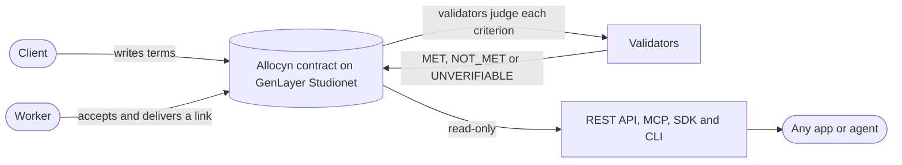
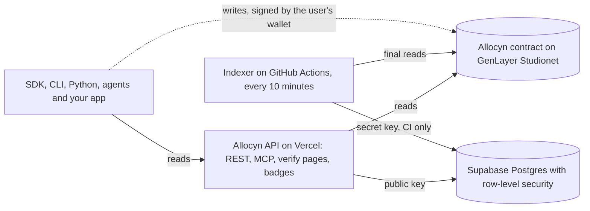

<div align="center">


<br>

**Verifiable infrastructure for work agreements, deliverables and on-chain verification.**<br>
Read it by REST, SDK, CLI or AI agents (MCP). Writes are always signed by your own wallet.

[](https://github.com/Said1235/allocyn-api/actions/workflows/ci.yml)


[**Documentation**](https://allocynapivercel.vercel.app/docs/) ·
[**REST reference**](https://allocynapivercel.vercel.app/docs/rest-reference.html) ·
[**Quickstart**](https://allocynapivercel.vercel.app/docs/quickstart.html) ·
[**Open the app**](https://allocyn.vercel.app/) ·
[**Changelog**](docs/content/16-changelog.md)

</div>

---

## What is Allocyn?

A **client** writes a job: a title, a description and 1 to 20 acceptance criteria. A **worker** accepts it and delivers a public link. **Validators** on [GenLayer](https://www.genlayer.com/) read the delivered page and judge it against each written criterion. Every step is recorded in the contract.

This repository is everything around that contract: a read-only API, a typed SDK, a CLI, a Python client, an MCP server for AI agents, an agent skill, a database index and the documentation.



## Highlights

| | |
|---|---|
| **Portable proof packs** | Save a job's verdict as one JSON file. Anyone can recheck it against the contract, without trusting the API, with `verifyProofPack()` or the CLI's `verify proof.json --chain`. It catches altered files, forged digests and jobs that changed. |
| **Evidence checks** | Has the delivered page changed since validators judged it? The page is downloaded and hashed on *your* machine and compared with the receipt's SHA-256. |
| **Public verify pages and badges** | `/verify/job-N` is a shareable page for one job, and `/v1/jobs/job-N/badge.svg` is a status badge you can put in a README. |
| **Built for AI agents** | 15 read-only MCP tools, an installable agent skill and a reference agent that reads jobs and follows changes. No tool can write. |
| **Fast lists, search and events** | An optional Supabase copy of the public data, refreshed by an indexer every 10 minutes: filters, full-text search, statistics, an event feed and an address record. Row-level security and a read-only public key. |
| **Guided actions** | `prepare` checks whether an action would be accepted and shows exactly what the person would sign. It never signs and sends nothing. |
| **Several ways in** | REST (16 endpoints, OpenAPI), TypeScript SDK, CLI, a one-file Python client (standard library only) and MCP. All generated from the same route table. |
| **Honest by design** | No payments, no escrow, no keys, no accounts. Everything is read from the contract, and the docs spell out what the tests cover. |

## Quick start

**Read a job with one request.** No account and no key:

```bash
API=https://allocynapivercel.vercel.app
curl -s $API/v1/meta
curl -s $API/v1/jobs/job-1            # { "success": true, "data": { ... } }
```

**Check a result without trusting anyone:**

```bash
curl -s $API/v1/jobs/job-1/proof > proof.json
npm run build -w @allocyn/cli         # builds packages/cli/dist/cli.js, the `allocyn` command
node packages/cli/dist/cli.js verify proof.json --chain   # re-reads the contract itself (needs @allocyn/sdk)
```

**TypeScript SDK** (reads work without a wallet; writes are signed by yours):

```ts
import { createAllocynClient, verifyProofPack } from "@allocyn/sdk";

const API = "https://allocynapivercel.vercel.app";
const allocyn = await createAllocynClient({ network: "studionet" });
const job = await allocyn.getJob("job-1");
const check = await verifyProofPack(await (await fetch(`${API}/v1/jobs/job-1/proof`)).json(), { reader: allocyn });
console.log(job.status, check.verdict);   // e.g. VERIFIED verified
```

**Give an agent the tools:**

```bash
claude mcp add --transport http allocyn https://allocynapivercel.vercel.app/mcp
```

**Python:**

```python
from allocyn_api import AllocynApi
api = AllocynApi("https://allocynapivercel.vercel.app", consistency="final")
print(api.get_job("job-1"))
```

The contract has no jobs yet at the time of writing, so `job-1` answers `JOB_NOT_FOUND` until the first job is created.

## How it fits together



## What is in the repository

| Path | What it is |
|---|---|
| [`packages/sdk`](packages/sdk) | `@allocyn/sdk`: reads, `verifyProofPack`, `checkEvidence`, and writes signed by the caller's own wallet. Never handles keys. |
| [`packages/api`](packages/api) | Zero-dependency Node HTTP server: REST, OpenAPI, MCP, verify pages, the indexer. No wallet, no endpoint that writes. |
| [`packages/cli`](packages/cli) | `allocyn`: one dependency-free file for jobs, events, addresses, evidence and `verify`. |
| [`clients/python`](clients/python) | One-file Python client generated from the route table. |
| [`skills/allocyn`](skills/allocyn) | Agent skill that teaches an agent how to read results correctly. |
| [`examples/agent`](examples/agent) | Reference agent: reads over MCP, whitelists read-only tools, follows changes. |
| [`supabase/migrations`](supabase/migrations) | The database copy: tables, row-level security, statistics, events. |
| [`docs`](docs) | The documentation site: guides, reference, search, diagrams and a live "Try it". |

## What Allocyn is not

Said plainly, so nobody builds on a wrong idea.

- **Not payments or escrow.** No money moves, and a verdict does not release or hold funds.
- **Not dispute resolution** and not a legal determination.
- **Not a measure of quality.** `VERIFIED` means validators judged that a public page met the written criteria. Verdicts come from LLM-assisted validators under consensus.
- **Not immune to prompt injection.** A delivered page is untrusted text that a model reads.
- **Not a custodian.** It holds no keys and no funds, and the API refuses to start if a private key is in its environment.

## Status

Studionet only.

- **Tested:** the SDK, the HTTP server, the docs build, the indexer and the proof packs run against an in-memory test double of the contract (`SimContract`), with fixtures generated by running the contract's own Python code. The CI also runs a daily live read check against Studionet.
- **Working in production:** the API and docs are deployed on Vercel and read the real contract; the Supabase copy and its indexer run against a real database.

## Develop

Node 22.6 or newer.

```bash
npm install
cp .env.example .env        # defaults point at Studionet
npm run docs:build
npm start                   # http://localhost:8787  (docs at /docs/, spec at /openapi.json)
npm test                    # sdk + api + cli + docs
node scripts/preview-server.mjs   # explore the API and docs on a simulated contract
```

Deploy on Vercel or any Node host: see [`docs/content/15-deploy.md`](docs/content/15-deploy.md). `api/index.mjs` is committed on purpose (Vercel needs it before the build); regenerate it with `npm run vercel:build`. When the contract changes, see "Updating the contract" in [`docs/content/12-networks.md`](docs/content/12-networks.md): a change in the limits is detected at runtime (`matchesPinned: false`) and writes are refused until the SDK is updated.

## The contract

Smart Agreement at [`0x5729a3b514654Ec5966A1DCa8e5088ef7A70bBDA`](https://explorer-studio.genlayer.com/address/0x5729a3b514654Ec5966A1DCa8e5088ef7A70bBDA) on GenLayer Studionet (chain 61999). Source: [`Said1235/Smart-Agreement`](https://github.com/Said1235/Smart-Agreement). Pinned source SHA-256: `58fd38776f25d54f22a9d1560f78b348215ac13d3a863d4f7be00609b9355f57`.

## Learn more

[Introduction](https://allocynapivercel.vercel.app/docs/introduction.html) ·
[Core concepts](https://allocynapivercel.vercel.app/docs/core-concepts.html) ·
[SDK reference](https://allocynapivercel.vercel.app/docs/sdk-reference.html) ·
[Agents and MCP](https://allocynapivercel.vercel.app/docs/agents-mcp.html) ·
[Verification results](https://allocynapivercel.vercel.app/docs/verification-results.html) ·
[Database copy](https://allocynapivercel.vercel.app/docs/database.html) ·
[Security](https://allocynapivercel.vercel.app/docs/security-privacy.html)

<div align="center">
<br>
<sub>Built on <a href="https://www.genlayer.com/">GenLayer</a> · <a href="https://docs.genlayer.com">GenLayer docs</a></sub>
</div>
